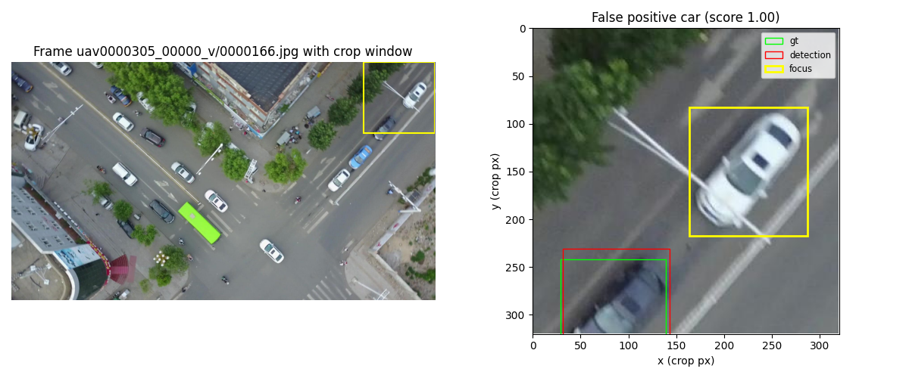

## Methodology and motivation

### Data preparation 

The data was given in 2 formats - YOLO and COCO. So firstly we took random 50 frames and checked the consistency between these to formats, so as result: we saw that all frames match, and the boxes lie on the objects correctly. Also check that labels are clean, there are no empty boxes, dublicates or boxes out of frames. About format: the torchvision models (Faster R-CNN, RetinaNet) use boxes from COCO in pixels, and Ultralytics (YOLO, RT-DETR) use YOLO format. Legacy notebooks took YOLO files directly, but current notebooks create their own from COCO (difference between these 2 types of notebooks is explained in Validation design).

In general, the objects that we need to detect are very small. So we downscale frames to 1280 (when standart from Ultralytics is 640), because when the size is 640 about 53.6% of objects will be smaller than 16 px, but when we resize to 1280 this percentage drops to 9.7%. Also in anchor-based models (RetinaNet and Faster R-CNN) add anchors of size 16 px (because standart is 32 px) 
([EDA, sections 4.1 and 4.2][eda])

Also the dataset classes are imbalanced:

| Class | Train | Val | Train, % | Val, % |
|---|---:|---:|---:|---:|
| car | 505,301 | 31,821 | 45.7 | 27.9 |
| person | 328,701 | 50,312 | 29.7 | 44.1 |
| motor | 102,819 | 12,025 | 9.3 | 10.5 |
| van | 46,940 | 6,842 | 4.2 | 6.0 |
| tricycle | 41,349 | 5,487 | 3.7 | 4.8 |
| bicycle | 40,255 | 6,022 | 3.6 | 5.3 |
| truck | 30,498 | 1,359 | 2.8 | 1.2 |
| bus | 9,653 | 264 | 0.9 | 0.2 |

*Source: [EDA, section 3.1][eda]*

We can see that car class dominates 45.7% in train over 0.9 % of bus class. Also other classes are in the minority if we compare to car and person classes. In val. part we have only 264 buses. So the mAP will be smaller due to small AP for the minority classes and also mAP is just average metrics for all classes. So to see the classes that the model distinguish badly, we calculate AP for each class separately. 

The other problem is ignored regions (regions that are not labeled) because they teach model to think that real object are just background noise. To handle it  so we painted them on with the mean color of the image during training, so models do not learn them as background. For validation use parameter `iscrowd` = 1, so the detections is these parts do not calculate as correct or incorrect. Non-target classes are handled same as ignored regions.
([EDA, section 7][eda])

Consecutive frames are very similar, if we compare them we can see that the same object on the current frame and the next one has a median IoU 0.9. So we decided to take only every 5th frame from train data (because after 5 frames the median IoU falls to 0.59), and the number of frames dropped from 24201 to 4868, it also make runtime smaller.
([EDA, sections 9 and 11][eda])

Frame density on train data has median 43.0 and val. 37.0, but max numbers are 180 and 116. As standard COCO use only 100 boxes, and in our case about 5% of data have over 100 objects, so we put the limit of 500 boxes for 1 frame.
([EDA, section 5][eda])

For each video we calculated its median size of the objects, average number of objects on frame mean_objects, resolution. The size varies from 24.5 to 86.8 px. A lot of video contains the major part of only 1 class. The resolution is from 1344x756 to 3840x2160. The average object capacity varies from about 6.1 to over 103.4 for one frame. Also validation part has only 7 videos, so the result will depend on the videos that were placed there. 
([EDA, sections 3.3 and 6][eda])


### Validation design

The split for train, validation and test was given from the start. Split is done by video, not by frames, to avoid data leakage. Train - 56 videos, val. - 7, so we didn't change here anything.
So we have two validation approaches: quick-validation(every 5th frame, total - 571) and full validation (2846 val. frames). First one we use to quick check the metrics after each epoch when the model is running, to see the progress or regress(as overfitting), also to choose the best epoch for the final results.  Full validation is used at the end, and calculate mAP when IoU is between 0.5 to 0.95, also has restrictions that we mentioned previously: limit of 500 objects detections for 1 frame (as on Kaggle), and ignored regions are given as `iscrowd` = 1. 

And the metrics that we calculate are: AP50, AP_small, AP for classes, speed (ms for frame). 

First 6 notebooks are done by legacy protocol. In that protocol we didn't paint ignored regions, ground-truth boxes didn't delete, Ultralytics models chose the best epoch using built in score for all val. frames.
After that we made new current protocol, it includes all what was described above plus fixation of seeds. In Results the legacy notebooks have distinct marks, because we can't fairly compare them with new protocol notebooks. 

## Results and analysis


### Two-stage models

**faster-cnn-5**\*. [(notebook)](./notebooks/faster-cnn-5.ipynb)

Initial Faster R-CNN model.

**faster-rcnn-small-anchors**. [(notebook)](./notebooks/faster-rcnn-small-anchors.ipynb)

Changed from `faster-cnn-5`: anchor sizes are reduced from 32-512 to 16-256, which should help with very small objects (EDA showed that most of the boxes are small). Later we have used this run as a baseline for Faster R-CNN models due to it being first one with the new experiment protocol.

**faster-rcnn-rpn-proposals**. [(notebook)](./notebooks/faster-rcnn-rpn-proposals.ipynb)

Changed from `faster-rcnn-small-anchors`: pre- and post-NMS number of proposal increased by factor of 2.

**faster-rcnn-giou**. [(notebook)](./notebooks/faster-rcnn-giou.ipynb)

Changed from `faster-rcnn-small-anchors`: replace the smooth L1 box loss with GIoU loss, as required by the homework.

**faster-rcnn-short-schedule**. [(notebook)](./notebooks/faster-rcnn-short-schedule.ipynb)

Changed from `faster-rcnn-small-anchors`: reduce number of epochs from 12 to 6. In previous runs we have seen that the model usually overfits on the first few epochs - so the last 6 epochs were useless. We test how metrics are sensitive to changing the number of epochs (which changes learning rate schedule).

**pipeline-frame-offsets**. [(notebook)](./notebooks/pipeline-frame-offsets.ipynb)

Changed from `faster-rcnn-short-schedule`: since in protocol we train on each fifth train frame, we only use 1/5 of the train set. In this notebook we rotate offset of the frame. I.e. split train frames into 5 sets, and each epoch rotates through those sets. This will increase the diversity in training.

**faster-rcnn-combined**. [(notebook)](./notebooks/faster-rcnn-combined.ipynb)

Changed from `faster-rcnn-giou`: reduce the number of epochs as in `faster-rcnn-short-schedule` and include frame offsets as in `pipeline-frame-offsets`. More augmentation was added.

**pipeline-class-balance**. [(notebook)](./notebooks/pipeline-class-balance.ipynb)

Changed from `faster-rcnn-small-anchors`: oversample frames with rare classes (such as bus) to fix the unbalanced training set.

### One-stage anchor-based models

**retinanet**\*. [(notebook)](./notebooks/retinanet.ipynb)

Initial RetinaNet model.

**retinanet-rerun**. [(notebook)](./notebooks/retinanet-rerun.ipynb)

Same initial RetinaNet model, but with the new protocol.

**retinanet-kmeans-anchors**. [(notebook)](./notebooks/retinanet-kmeans-anchors.ipynb)

Changed from `retinanet-rerun`: anchor sizes for the model were changed and generated from the data, rather set manually as in `faster-rcnn-small-anchors`. The number of anchors was reduced from 45 to 15.

**retinanet-iou-thresholds**. [(notebook)](./notebooks/retinanet-iou-thresholds.ipynb)

Changed from `retinanet-rerun`: reduced `fg_iou_thresh` from 0.5 to 0.4 and `bg_iou_thresh` from 0.4 to 0.3. Since most of the objects are very small and `retinanet-run` had only 18.6% of small objects with best IoU >= 0.5.

**retinanet-anchors-16-256**. [(notebook)](./notebooks/retinanet-anchors-16-256.ipynb)

Changed from `retinanet-rerun`: anchor sizes for the model were changed similarly to `faster-rcnn-small-anchors`. After this we have decided to drop the `retinanet` direction.

### Anchor-free models

**baseline-yolo-2**\*. [(notebook)](./notebooks/baseline-yolo.ipynb)

Initial Yolo11s model.

**yolo-3-1280**\*. [(notebook)](./notebooks/yolo-3-1280.ipynb)

Changed from `baseline-yolo-2`: increase resolution from 640 to 1280. The same argument: almost all objects are small, which requires better resolution at them.

**yolo11s-1280-rerun**. [(notebook)](./notebooks/yolo11s-1280-rerun.ipynb)

Same as `yolo-3-1280`, but with the new protocol.

**yolo11s-1280-p2**. [(notebook)](./notebooks/yolo11s-1280-p2.ipynb)

Changed from `yolo11s-1280-rerun`: add fine-grained detection level (P2) to already used P3-P5. Increase of resolution has improved precision (AP_small) for small object, so we try to work on this further. Since more memory will be required with the new detection level, batch size was reduced by a factor of two.

**yolo11s-p2-combined**. [(notebook)](./notebooks/yolo11s-p2-combined.ipynb)

- Training happened on all frames, instead of every fifth;
- Epochs reduced from 30 to 6 (since peak quickval mAP was reached earlier);
- `warmup_epochs` and `close_mosaic` were scaled appropriately;
- Since the smallest image is 680px wide and is upscaled by a factor of 1.88, the augmentation now includes this factor (changed scaling range from (0.5, 1.5) to (0.5, 2));
- There is a large difference between mean grey value of train set and test set, thus we have widened the augmentation for color (HSV value is multiplied now by a factor from (0.3, 1.7), insead of (0.6, 1.4)).

**yolo11s-p2-robustness**. [(notebook)](./notebooks/yolo11s-p2-robustness.ipynb)

This notebook uses the `yolo11s-p2-combined` without any training (weights are transfered). Because this model has a very high gap between internal validation and public LB score - we decided to test how the model performs on extreme conditions (scaling and brightness reduction). Since the metrics didn't reduce much - it showed that the model is robust.

**yolo11s-p2-combined-trainval**. [(notebook)](./notebooks/yolo11s-p2-combined-trainval.ipynb)

Train 1 epoch with the same schedule as in `yolo11s-p2-combined` on `train`+`validation` splits. This has no validation metrics and is used purely for submission - it was chosen because `yolo11s-p2-combined` performs the best among the single-model cases.

### Query-based models

**rt-detr**\*. [(notebook)](./notebooks/rt-detr.ipynb)

Initial RT-DETR model.

**rt-detr-tuned-lr**\*. [(notebook)](./notebooks/rt-detr-tuned-lr.ipynb)

Changed from `rt-detr`: automatic learning rate (was 0.00083) changed to 0.0001.

**rtdetr-l-queries-500**. [(notebook)](./notebooks/rtdetr-l-queries-500.ipynb)

Changed from `rt-detr-tuned-lr`: protocol update and number of queries in the decoder (500 instead of 300). Warmup bias learning rate is set to 0, because it caused 0.00000 mAP.

### Pipelines

**pipeline-ensemble-wbf**. [(notebook)](./notebooks/pipeline-ensemble-wbf.ipynb)

The first ensemble model that fuses `faster-rcnn-small-anchors`, `faster-rcnn-rpn-proposals`, `faster-rcnn-giou`, `pipeline-class-balance` and `yolo11s-1280-p2` using class-wise weighted boxes fusion mechanism.

The parameters are tuned from the following values:

```python
WBF_IOU_THRESHOLD_GRID = (0.5, 0.55, 0.6, 0.65, 0.7, 0.75)
WBF_SKIP_BOX_THRESHOLD_GRID = (0.001, 0.01, 0.05)
WBF_WEIGHT_GRID = (0.5, 1.0, 2.0)
```

The search for IoU threshold and skip box threshold is grid-search while all weights = 1.0; then greedy search over (0.5, 1.0, 2.0) for weights.

**pipeline-ensemble-extended**. [(notebook)](./notebooks/pipeline-ensemble-extended.ipynb)

Changed from `pipeline-ensemble-wbf` - included more models:
- `faster-rcnn-short-schedule`
- `faster-cnn-5` (legacy protocol)
- `rt-detr-tuned-lr` (legacy protocol)
- `yolo-3-1280` (legacy protocol)
- `retinanet` (legacy protocol)

Grid for IoU threshold and skip box threshold was reduced.

**pipeline-temporal**. [(notebook)](./notebooks/pipeline-temporal.ipynb)

Tested methods for temporal correction of predictions. Since data comes from sequential frames, we can use this information too. Three methods are tested along with their combination:

- Views - WBF fusing between previous, this and next frames.
- Views compensated - estimate homography between previous, this and next frames using ORB and project boxes using it.
- Track smoothing - smooth scores of detections between frames;
- Track recovery - low-scored detections are included in tracks and their score is lifted.

Then after tuning each separately, successful methods are combined: views compensated, track smoothing and track recovery.

**pipeline-inference**. [(notebook)](./notebooks/pipeline-inference.ipynb)

Tune `faster-rcnn-small-anchors`, `faster-rcnn-giou` and `yolo11s-1280-p2` parameters, that could be changed during inference.

Then fused into ensemble model.

**pipeline-final**. [(notebook)](./notebooks/pipeline-final.ipynb)

Changed from `pipeline-ensemble-extended` - removed and included more models. The detailed table is available in the notebook. The removal of some model is argued because of their small influence to the final score (checked by ablation). It also include `pipeline-inference` with the same model but at different views/parameters.

**pipeline-final-temporal**. [(notebook)](./notebooks/pipeline-final-temporal.ipynb)

Final ensemble with temporal corrections. See *Final model and run instructions* for the details.

### Metrics

The following table summarizes all runs and their metrics:

| Run | mAP@500 | AP50 | AP_small | ms/img | Public LB | Train, h |
|---|---|---|---|---|---|---|
| [faster-cnn-5](./notebooks/faster-cnn-5.ipynb) | 0.2416\* | 0.4799\* | 0.0994\* | 198.3\* | 0.21972 | 3.37\* |
| [faster-rcnn-small-anchors](./notebooks/faster-rcnn-small-anchors.ipynb) | 0.2312 | 0.4797 | 0.1212 | 179.0 | 0.24489 | 3.20 |
| [faster-rcnn-rpn-proposals](./notebooks/faster-rcnn-rpn-proposals.ipynb) | 0.2290 | 0.4789 | 0.1194 | 239.9 | 0.2332 | 3.56 |
| [faster-rcnn-giou](./notebooks/faster-rcnn-giou.ipynb) | 0.2371 | 0.4896 | 0.1312 | 241.8 | 0.22569 | 3.31 |
| [faster-rcnn-short-schedule](./notebooks/faster-rcnn-short-schedule.ipynb) | 0.2287 | 0.4738 | 0.1064 | 237.7 | n/a | 1.65 |
| [retinanet](./notebooks/retinanet.ipynb) | 0.2055\* | 0.3861\* | 0.0569\* | 113.8\* | 0.2142 | 2.40\* |
| [retinanet-rerun](./notebooks/retinanet-rerun.ipynb) | 0.1968 | 0.3814 | 0.0757 | 112.4 | n/a | 2.42 |
| [retinanet-kmeans-anchors](./notebooks/retinanet-kmeans-anchors.ipynb) | 0.1092 | 0.2958 | 0.0636 | 114.5 | 0.09991 | 2.37 |
| [retinanet-iou-thresholds](./notebooks/retinanet-iou-thresholds.ipynb) | 0.1596 | 0.3033 | 0.0497 | 180.1 | 0.16656 | 2.66 |
| [retinanet-anchors-16-256](./notebooks/retinanet-anchors-16-256.ipynb) | 0.1901 | 0.3999 | 0.0708 | 170.2 | 0.17558 | 2.54 |
| [baseline-yolo-2](./notebooks/baseline-yolo.ipynb) | 0.1375\* (@100) | 0.2733\* | 0.0498\* | **8.0**\* | 0.13875 | 1.05\* |
| [yolo-3-1280](./notebooks/yolo-3-1280.ipynb) | 0.1930\* | 0.3748\* | 0.0900\* | 27.7\* | 0.19618 | 2.71\* |
| [yolo11s-1280-p2](./notebooks/yolo11s-1280-p2.ipynb) | 0.2165 | 0.4288 | 0.1146 | 45.0 | 0.21419 | 5.13 |
| [yolo11s-1280-rerun](./notebooks/yolo11s-1280-rerun.ipynb) | 0.1921 | 0.3793 | 0.1163 | 33.9 | n/a | 3.47 |
| [rt-detr](./notebooks/rt-detr.ipynb) | 0.240\* | 0.448\* | 0.097\* | 41.6\* | n/a | 3.24\* |
| [rt-detr-tuned-lr](./notebooks/rt-detr-tuned-lr.ipynb) | 0.2123\* | 0.4046\* | 0.0889\* | 42.8\* | n/a | 3.34\* |
| [rtdetr-l-queries-500](./notebooks/rtdetr-l-queries-500.ipynb) | 0.2403 | 0.4530 | 0.0980 | 45.6 | 0.26965 | 4.09 |
| [pipeline-class-balance](./notebooks/pipeline-class-balance.ipynb) | 0.2247 | 0.4613 | 0.1163 | 251.4 | 0.25857 | 3.43 |
| [pipeline-ensemble-wbf](./notebooks/pipeline-ensemble-wbf.ipynb) | 0.2747 | 0.5268 | 0.1541 | 1054.1 | 0.2743 | 0.91 |
| [pipeline-ensemble-extended](./notebooks/pipeline-ensemble-extended.ipynb) | 0.2904 | 0.5410 | 0.1521 | 1848.1 | 0.28856 | 2.34 |
| [pipeline-temporal](./notebooks/pipeline-temporal.ipynb) | 0.2951 | 0.5501 | 0.1535 | 1998.4 | 0.30402 | 0.49 |
| [pipeline-frame-offsets](./notebooks/pipeline-frame-offsets.ipynb) | 0.2429 | 0.4955 | 0.1098 | 240.2 | 0.23211 | 1.67 |
| [yolo11s-p2-combined](./notebooks/yolo11s-p2-combined.ipynb) | 0.2365 | 0.4521 | 0.1266 | 44.6 | 0.28689 | 4.12 |
| [pipeline-inference](./notebooks/pipeline-inference.ipynb) | 0.2862 | 0.5435 | 0.1589 | 1720.6 | 0.2699 | 4.80 |
| [yolo11s-p2-robustness](./notebooks/yolo11s-p2-robustness.ipynb) | — | — | — | 44.0 | n/a | 0.21 |
| [faster-rcnn-combined](./notebooks/faster-rcnn-combined.ipynb) | 0.2462 | 0.4934 | 0.1261 | 239.9 | 0.24228 | 1.75 |
| [pipeline-final](./notebooks/pipeline-final.ipynb) | 0.3117 | 0.5710 | 0.1722 | 4791.4 | 0.31008 | 4.79 |
| [pipeline-final-temporal](./notebooks/pipeline-final-temporal.ipynb) | **0.3169** | **0.5826** | **0.1738** | 4950.5 | **0.32333** | 0.21 |
| [yolo11s-p2-combined-trainval](./notebooks/yolo11s-p2-combined-trainval.ipynb) | — | — | — | 45.5 | 0.24967 | 0.76 |

\* The evaluation was done using "legacy" protocol.

### Conclusions

The variation of mAP is very large, which can be seen in the difference between Public LB and internal validation, which is especially seen for `yolo11s-p2-combiner` with ~0.05 of difference.

This means that the models are very noisy, in the best case we should have introduced bootstraping and evaluate how model metrics change with different data on the input. This could also be explained by *Failure analysis* case.

Ensembles give the best internal validation and Public LB metrics, which could also explain the above - ensembles reduce variance in the predictions.

### Failure analysis



The above image is an example of when does the `pipeline-class-balance` fails (false positive car). I.e. model finds the car, when there is no label of a car. One can definetely see that the car is there, but dataset has no label for it. And this is only a signle case, thus dataset is not very precise.

## Final model and run instructions

The final model that also has performed the best on the private leaderboard is the ensemble with temporal corrections [pipeline-final-temporal](./notebooks/pipeline-final-temporal.ipynb).

This model is based on [pipeline-final](./notebooks/pipeline-final.ipynb) and uses its ensemble weights with addition of temporal corrections.

The temporal correction is fully copied from [pipeline-temporal](./notebooks/pipeline-temporal.ipynb).

To reproduce the results do the following steps:
1. Upload the `pipeline-final-temporal` notebook
2. Check notebook's variable `SOURCE_KERNELS`. Each element of this list is another notebook (replace owner prefix with your own).
3. Upload each notebook from those sources to the Kaggle.
4. Repeat the above steps for the uploaded notebooks.
5. For each notebook add competition's dataset and it's parent notebooks from `SOURCE_KERNELS`.
6. Run all notebooks starting with those that have no dependencies until you have run `pipeline-final-temporal`. Use GPU instance on Kaggle.
7. `pipeline-final-temporal` will produce `submission.csv` in the output of the notebook.

All seeds, model settings and python dependencies are already set/installed by the notebooks, so the above steps are enough to reproduce the results.

[eda]: https://github.com/dmnkpt1/ucu-ai-hw2/blob/main/notebooks/eda.ipynb
